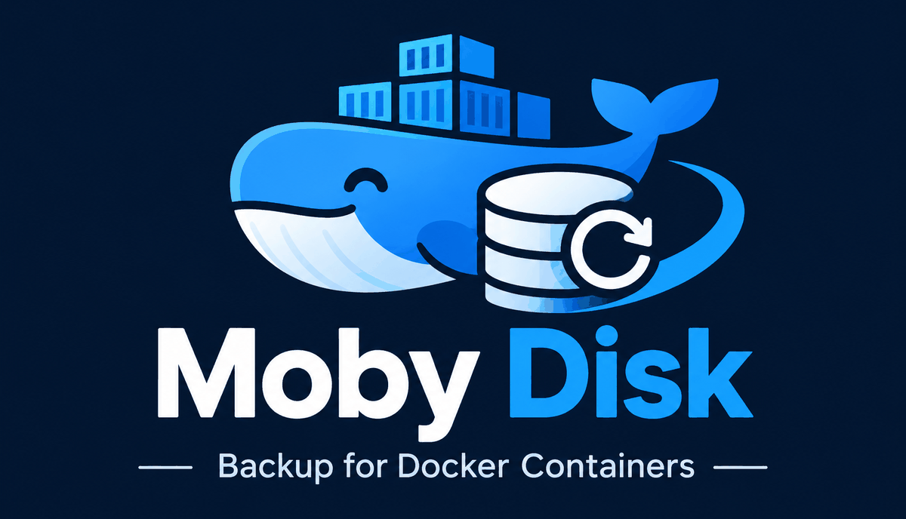

<p align="center"></p>

# Moby Disk

**Backups für Docker-Container.** Moby Disk sichert Volumes, Bind-Mounts und die Container-Konfiguration – konsistent, mit Datenbank-Dumps, Hooks und
Compose-Stacks –, übergibt die Sicherungen an eine Backup-Lösung eurer Wahl und stellt einzelne Container oder ganze Stacks wieder her, auf Wunsch als
isolierten Klon zum Ausprobieren. Alles über ein kleines Webinterface, in einem einzigen Container.

## Was es kann

- **Konsistent sichern:** Container kurz stoppen oder live sichern, Pre-/Post-Hooks, Datenbank-Dumps (MariaDB/MySQL, PostgreSQL, MongoDB, Redis/Valkey), Compose-Stacks gemeinsam
  und in Abhängigkeitsreihenfolge.
- **Eigene Ziele statt Insellösung:** Commvault, Veeam, Proxmox Backup Server, restic oder eigene Skripte – auch mehrere gleichzeitig (z. B. Commvault im Haus, restic in der Cloud).
  Lokale Kopien werden erst gelöscht, wenn sie in **allen** gewählten Zielen bestätigt sind.
- **Zurückholen:** aus der lokalen Kopie oder direkt aus einem Ziel, ins Original oder als **Klon**; ganze Stacks auf einen gemeinsamen Stand; Datenbank aus dem Dump neu aufbauen;
  Container samt Image neu anlegen.
- **Vorsichtig mit Großem:** Netzwerkspeicher, Mediensammlungen und Größenlimits werden erkannt; nur selbst gebaute Images werden mitgesichert, öffentliche exakt per Digest nachgeladen.
- **Überblick:** Schutzstatus je Container, Kapazitätsprognose, Zeitpläne, Benachrichtigungen (Webhook, ntfy, E-Mail, Heartbeat).
- **Im Griff:** Aufträge lassen sich pausieren und abbrechen, jederzeit an sicheren Stellen.

| Ziel | Art | Was Moby Disk tut | Geprüft |
| --- | --- | --- | --- |
| **Commvault** | wird abgeholt | legt die Archive ab, stößt den Subclient per REST an, wartet, liest Stände zurück, pflegt direkt gesicherte Pfade, Synthetic Full | produktiv im Einsatz |
| **Veeam** | wird abgeholt | startet einen Job in Veeam Backup & Replication per REST, wartet auf das Ende, prüft die Restore-Punkte | Nachbau des Servers (noch nicht gegen echtes Veeam) |
| **Proxmox Backup Server** | schreibt selbst | lädt jede Sicherung als Snapshot in einen Datastore, optional clientseitig verschlüsselt | echter PBS im Test (`dockurr/proxmox-backup`) |
| **restic** | schreibt selbst | pro Sicherung ein verschlüsselter, deduplizierter Snapshot (lokal, SFTP, S3/MinIO, B2, rest-server …) | echtes Repository im Test |
| **Befehl/Skript** | beides | ruft eigene Befehle auf – für Borg, Kopia, rclone, Bacula oder ein eigenes Skript | Skript-Tests |

## Schnellstart

```bash
git clone https://github.com/meni555/moby-disk.git moby-disk && cd moby-disk
sudo mkdir -p /opt/docker-backups
cp .env.example .env && chmod 600 .env
nano .env                    # APP_PASSWORD, TARGETS und die Zugangsdaten der Ziele
docker compose up -d --build
```

Dann `http://<host>:8484` öffnen (standardmäßig nur auf `127.0.0.1` gebunden – für Zugriff aus dem Netz einen Reverse-Proxy mit TLS davorsetzen),
unter **Einstellungen → Backup-Ziele** den Verbindungstest ausführen und ein erstes Backup starten. Ohne Ziel bleiben die Sicherungen lokal unter `/opt/docker-backups`.

Das Webinterface hat Root-Rechte auf dem Host (Docker-Socket) – lest vor dem Betrieb im Netz die [Sicherheitshinweise](docs/security.md).

## Dokumentation

| Seite | Inhalt |
| --- | --- |
| [Installation und Betrieb](docs/installation.md) | Voraussetzungen, Compose-Datei, alle Umgebungsvariablen, Datenordner, Reverse-Proxy, Aktualisieren, Umstieg vom CV Docker Helper |
| [Backup-Ziele](docs/targets.md) | Commvault, Veeam, Proxmox Backup Server, restic, Befehl/Skript – Einrichtung, Fähigkeiten, Besonderheiten, mehrere Ziele und Aufbewahrung |
| [Bedienung](docs/usage.md) | Container, Backup starten, Jobs (pausieren/abbrechen), Backups-Tab, Zeitpläne, Kapazität, Benachrichtigungen, Einstellungen |
| [Backup-Umfang und Einstellungen](docs/scope-and-settings.md) | was gesichert wird und was nicht, Labels, Host-Freigaben, Images, Datenbank-Dumps, Hooks, Compose-Stacks |
| [Restore](docs/restore.md) | Optionen, Ablauf, Quellen, Klon, Notfall ohne Oberfläche |
| [Sicherheit](docs/security.md) | Rechte, Zugangsdaten, Verschlüsselung, Protokolle |
| [Fehlersuche](docs/troubleshooting.md) | typische Meldungen je Ziel und ihre Abhilfe |
| [Entwicklung](docs/development.md) | Aufbau, Tests, ein neues Ziel hinzufügen, JSON-API |
| [Änderungen](CHANGELOG.md) | was sich wann geändert hat |

## Lizenz

[MIT](LICENSE). Die Schriften IBM Plex Sans und Mono liegen unter der SIL Open Font License (`app/static/fonts/LICENSE-IBM-Plex.txt`).
